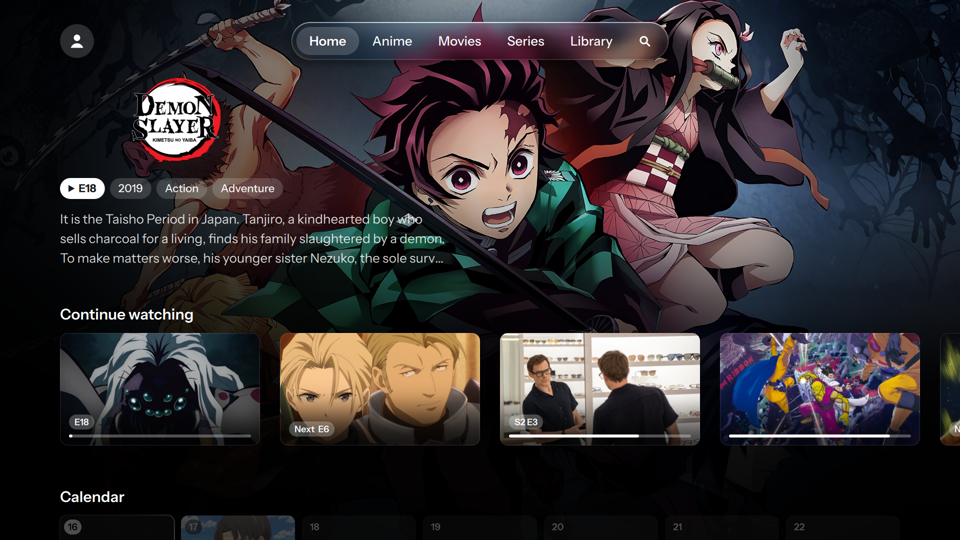
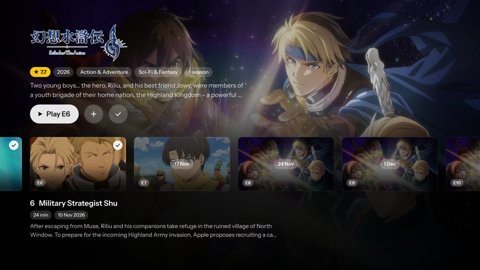
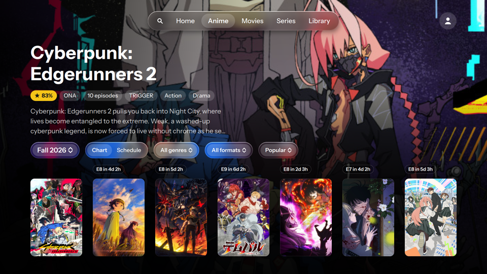
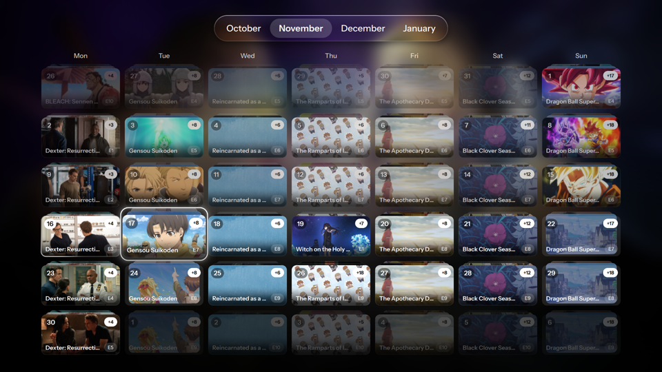
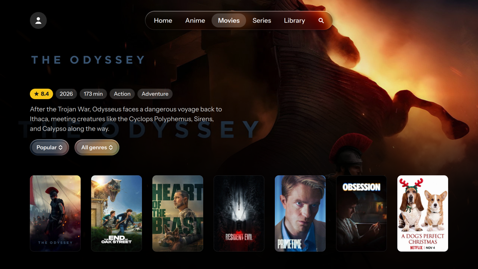
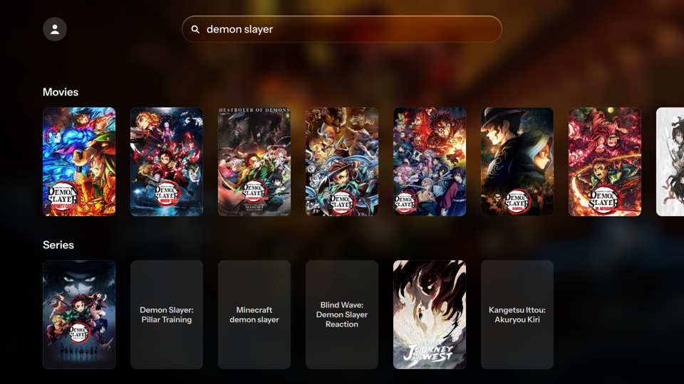
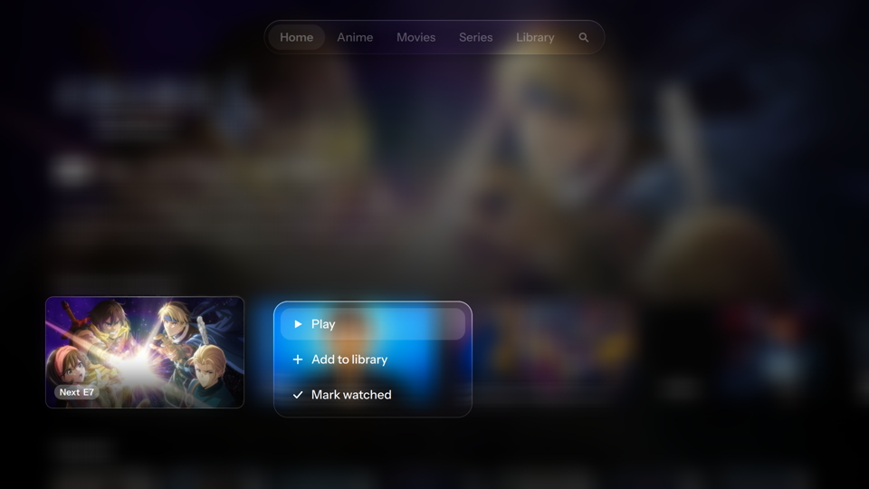

# Seimio

A native Stremio client for LG webOS TVs, written in QML (Qt 5.12, run by the TV's own `qml-runner`)
with a C++ plugin for LG's media server and libass subtitles. Built and measured on an LG C5 (webOS 26).

| | |
|---|---|
|  |  |
|  |  |
|  |  |
|  |  |

These are the visual check's approved renders (`tools/preview/shots.sh`), so they change with the app.

## Layout

| Path | What |
|---|---|
| `app/` | The webOS app package: `appinfo.json`, `main.qml` (loads the plugin, then `qml/App.qml`) |
| `app/Seimio/UI/` | The UI library (`import Seimio.UI 1.0`): theme, controls, glass and frost, cards, strips |
| `app/qml/` | Screens built from the library: Home, the show page, the title page (movies, single episodes), quick actions |
| `native/` | The `Seimio.Native` plugin (Luna calls, the media server player, libass subtitles, window properties, lab probes) and `Seimio.Data` (the catalog and the calendar model, in C++) |
| `core/` | Stremio's own core (stremio-core, Rust) behind a C interface, built for the TV and the Mac: the account, the library, Continue Watching, watch state |
| `third_party/libass/` | libass with FriBidi and HarfBuzz, built for the TV |
| `tools/` | Deploy, remote-driven tours, the lab server, art fetching, Mac previews |
| `lab/` | Earlier experiments (web motion lab, QML benchmarks, video tests) |
| `android/` | The Android TV build: the same QML and data code in Qt 6, the player over mpv (`mpv.h`), stand-ins for what only the LG has |

## How focus works

Controls handle their own keys: `CardStrip` and `ButtonRow` take Left/Right and OK, `MenuList` takes
Up/Down and OK, `SegmentedBar` takes Left/Right. Anything a control doesn't use bubbles up to its
screen (Up/Down between zones), then to `App`, which handles Back and decides which screen has focus
(`layer`). Selection state is one value, `displayItem`, changed only through `App.commit()`.

OK goes through `OkPress` in each control and one app-wide gesture in `Remote`, which tells a tap from
a hold (LG's remote sends a held key as release and press pairs). A hold that opens quick actions keeps
its owner, so the rest of the hold can't press anything in the menu.

## Rules and checks

`AGENTS.md` holds the performance and visual rules and the check to run before pushing
(`tools/check.sh`).

## Building and running

1. `tools/fetch-tv-libs.sh` copies the TV's Qt and LG libraries into `tvlibs/` (dev mode, SSH key at `~/.ssh/tv_key`).
2. `third_party/libass/build.sh`, `core/build.sh` (Stremio's core, Rust), then `native/build.sh` (Docker; the
   webOS toolchain is cached in `~/Library/Caches/webos-sdk`).
3. The app signs in to Stremio itself (a code to approve on a phone) and takes the account from Stremio's
   core. Everything else it fetches live from the services when it starts (`native/src/live.h`); nothing
   is baked in.
4. `python3 -I tools/lab-server.py &` then `tools/deploy.sh`.
5. `tools/tour.sh home|calendar|show|menu|play|streams|player` drives the TV with the network remote and prints frame pacing.
6. `tools/preview/build-data.sh` builds `Seimio.Data` for the Mac, then `tools/preview/shot.sh out.png`
   renders the app on the Mac (Qt 5 from Homebrew) for screenshots;
   `tools/preview/shots.sh` compares fixed states with the approved images, replaying recorded API answers
   (`tools/preview/api/`, `--record` to refresh) so the renders don't change with the day's data.
7. `android/build.sh install` builds the Android TV app (32-bit ARM, Qt 6 for Android in `~/Qt`, the SDK and NDK in
   `~/Library/Android/sdk`) and puts it on the TV over adb. It fetches libmpv once and compiles the QML's shaders
   for Qt 6 (`android/stage.py`).
